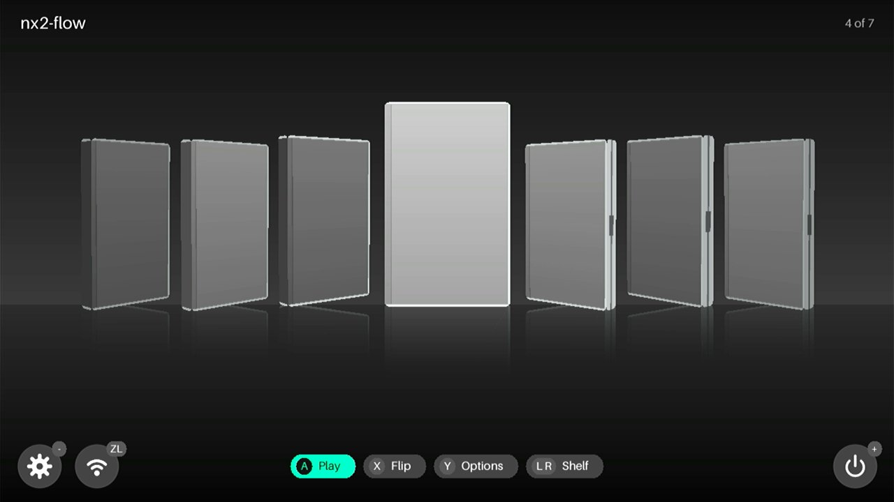

# nx2-flow

> [!WARNING]
> **Experimental. Use it at your own risk.** No warranty: the authors take no responsibility for any damage or loss (console,
> card, saved data, account).

> [!IMPORTANT]
> **Use dumps of games you own, made by you.** No game, key or console file is part of this project, and none will be provided.

A launcher for Switch 2 games kept as **NUP files** on the card: a shelf of your games, in the manner of WiiFlow, and a loader
that runs the one you pick straight from its NUP file. Nothing is built for each game on a computer.



*The shelf as the console shows it (one of its eight styles), with stand-in games that have neither a name nor a cover.*

**Work in progress.** It has been tried with few games and one setup (kaiHEN 20261117.1).

## The two programs

| folder | program | what it is | license |
|---|---|---|---|
| `menu/` | `nx2-flow.nro` (Switch 2) | The shelf: lists the NUP files of a folder with their covers or icons, each game's options (detailed log, mod set, slot of saved data, advanced settings), receives files from a computer. | GPL-2.0-or-later |
| `loader/` | `nx2-game.nro` (Switch 2) | The game loader: runs one NUP file. Started by the menu. | MIT (Zstandard's decoder in `third_party/`: BSD) |

The menu is built from the interface of [toronja](https://github.com/Olmectron/toronja), hence its license.
The loader is the runtime of [nx2-relink](https://github.com/Olmectron/nx2-relink) with no game built into it.

`docs/layout.md` says what is where on the card and how the programs talk to one another.

## On the card

```
/switch/nx2-flow/nx2-flow.nro      the menu (what the homebrew menu shows)
/switch/nx2-flow/nx2-game.nro      the game loader
/nx2-flow/games/                   your NUP files (another folder can be picked in the menu)
/nx2-flow/covers/                  covers
/nx2-flow/<title id>/              one folder for each game: saved data, logs, mods, settings
```

Open the homebrew menu over a game (hold R while starting it), start **nx2-flow**, pick a game.

## Your own cover

Any picture can be a game's cover: put it on the card, named by the game's title id.

```
/nx2-flow/covers/<title id>.jpg         the front only
/nx2-flow/covers/full/<title id>.jpg    the whole wrap: back, spine and front, left to right
```

- The title id is 16 hex digits: the name of the game's folder in `/nx2-flow/` (it is made the first time the game is started).
- `.jpg`, `.jpeg` or `.png`. With both a front and a wrap, the wrap is shown.
- The picture is fitted to the case, so its shape matters more than its size: a front is about 0.615 as wide as it is tall
  (500 × 813, say), a whole wrap about 1.3 times as wide as it is tall (1300 × 1000).
- A game with no cover stands as a case made of its own icon and name.

The menu's Transfer screen takes the file from a computer; `menu/README.md` has the other way to get covers (GameTDB).

## What to know

- **Which game the homebrew menu is started over matters.** To the console the running program is that game, and has what that
  game may have: its memory for graphics, its "system resource", the services it may open. The loader stands in for the services
  a game can run without (network, online data, amiibo and the like) and says so in the game's log; it can't for the rest. The
  surest host is the same game.
- **Not every game runs.** A game with more modules than the console's loader service maps for one program, or one that loads
  many modules of its own as it runs, needs a port made for it with nx2-relink.
- **Mods.** A file put in the game's folder under `mods/`, at the path it has inside the game, is what the game gets in place of
  its own. More sets go in `modsets/<name>/`; the menu picks which is in use.
- **Slots of saved data.** Each slot is a folder of the game's own saved data; the menu makes, copies and picks them.
- **When a game ends badly**, its folder has `crash.txt`: the file to send with a report.

## Building

Each folder has its own README. In short: devkitPro (devkitA64), ounce-devkit (libounce) for the two programs, Python 3.10 or newer for the loader's build script.
